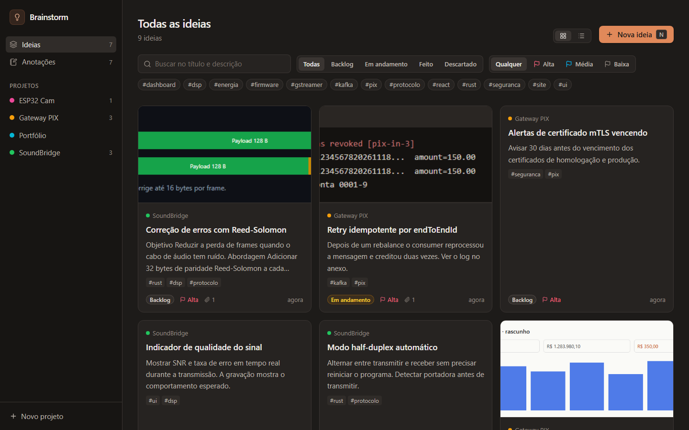
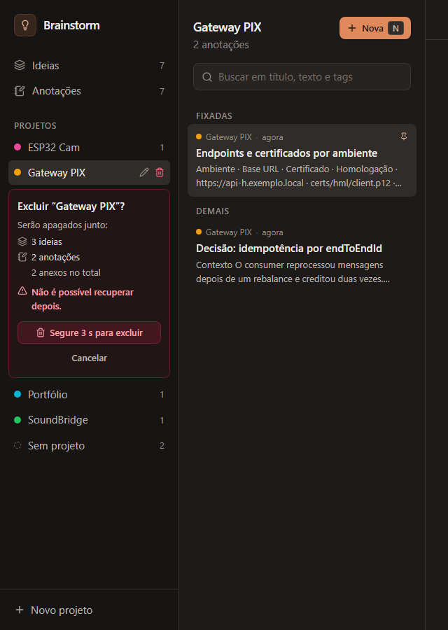
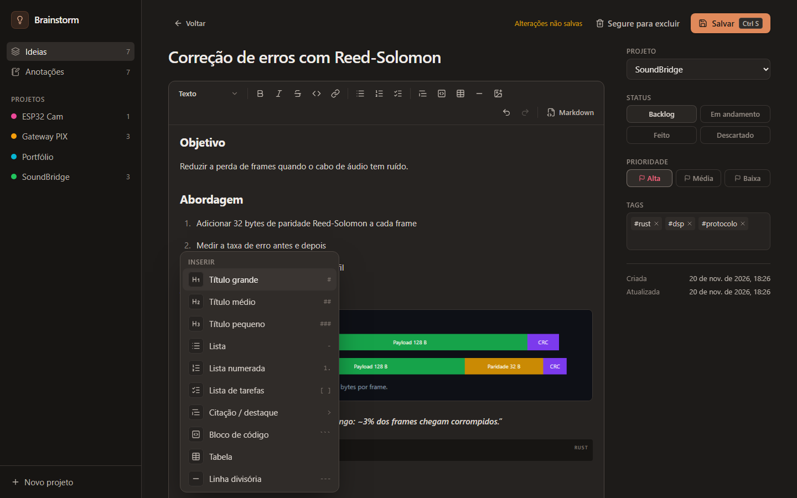
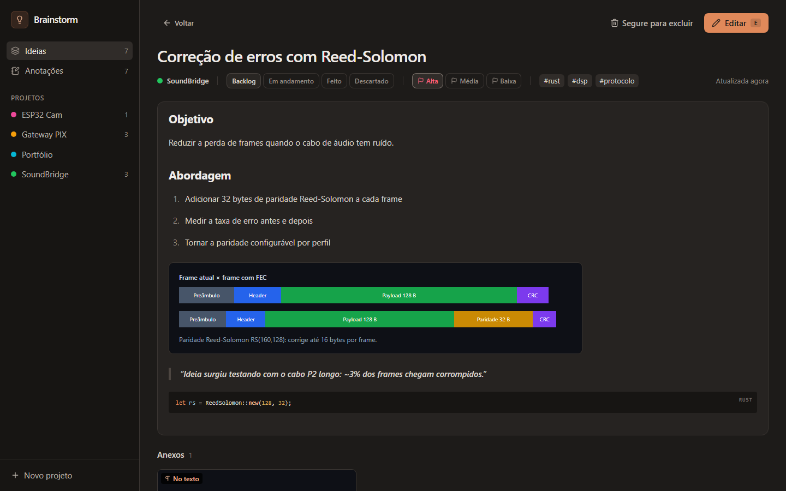
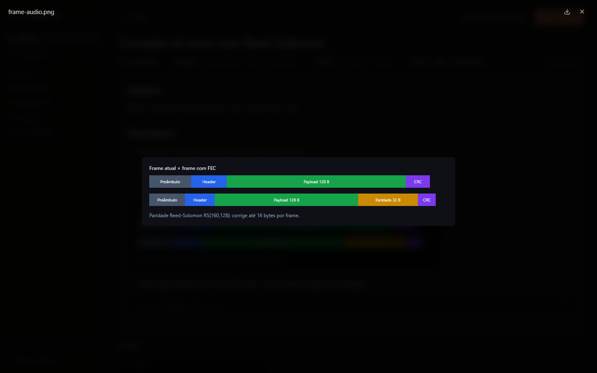
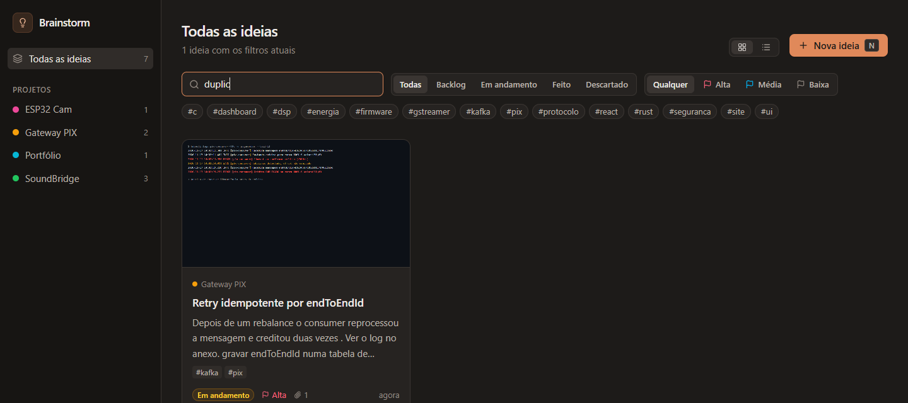
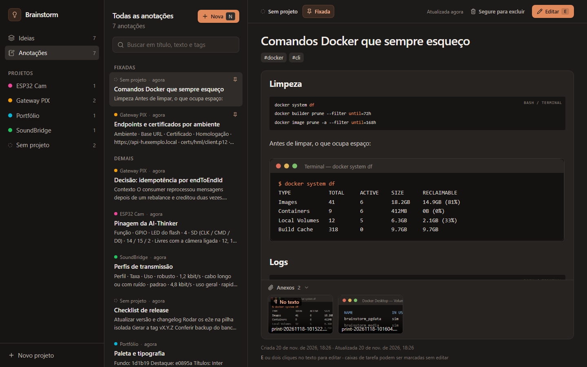
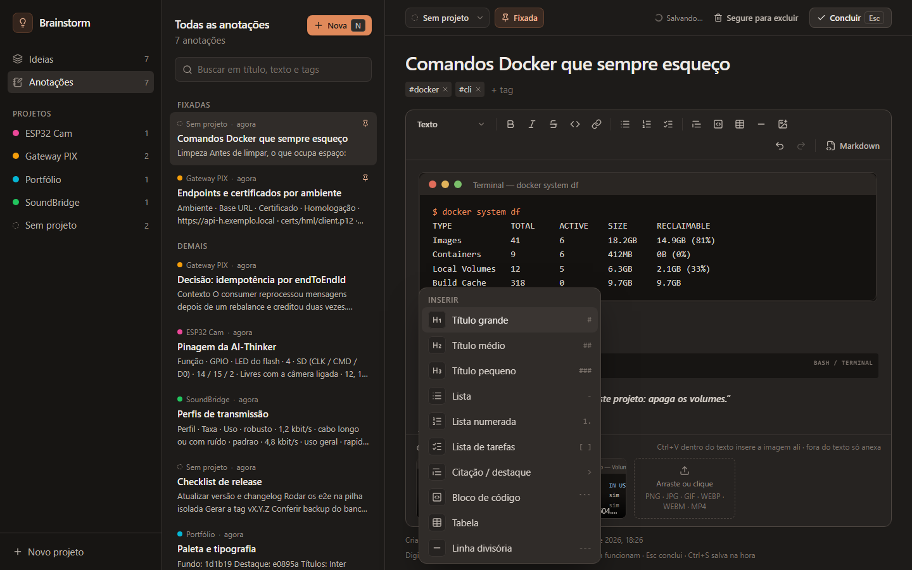
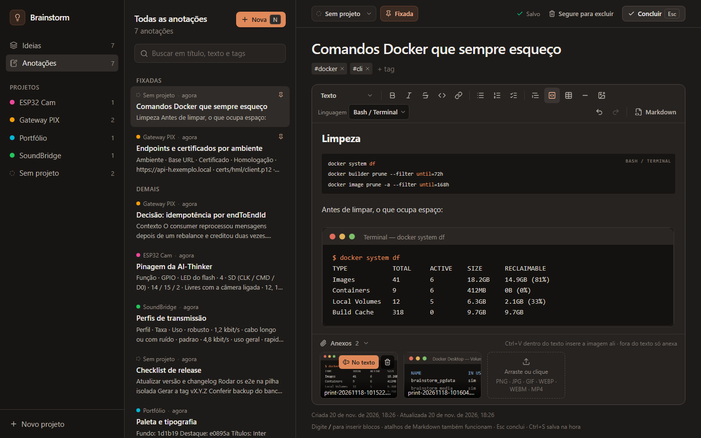

# Brainstorm

Um lugar para guardar as ideias que aparecem no meio do trabalho e que você não pode tocar agora, e as anotações que você consulta sempre: comandos, endereços, decisões, pinagens. Cada ideia e cada anotação fica com texto formatado, prints e gravações de tela, organizada por projeto, para você retomar depois sem perder o contexto.



---

## Sumário

1. [Como abrir](#como-abrir)
2. [Como a ferramenta se organiza](#como-a-ferramenta-se-organiza)
3. [Criar um projeto](#criar-um-projeto)
4. [Registrar uma ideia](#registrar-uma-ideia)
5. [Escrever o texto](#escrever-o-texto)
6. [Anexar prints e vídeos](#anexar-prints-e-vídeos)
7. [Encontrar ideias](#encontrar-ideias)
8. [Editar, concluir e excluir](#editar-concluir-e-excluir)
9. [Anotações](#anotações)
10. [Atalhos de teclado](#atalhos-de-teclado)
11. [Limites e cuidados](#limites-e-cuidados)
12. [Testes automatizados](#testes-automatizados)

---

## Como abrir

O Brainstorm roda no seu computador, dentro do Docker.

1. Com o Docker Desktop aberto, rode na pasta do projeto:

   ```bash
   docker compose up -d
   ```

2. Acesse **http://localhost:8090** no navegador.

Para desligar, use `docker compose down`. Suas ideias, anotações e anexos continuam guardados para a próxima vez.

### Atualizar para uma versão nova

Quando o código mudar, reconstrua com `docker compose up -d --build`. Na primeira subida, a API ajusta o banco sozinha (cria as tabelas novas sem apagar nada). Antes de atualizar, vale fazer um backup do banco:

```bash
docker compose exec db pg_dump -U brainstorm brainstorm > backup-brainstorm.sql
```

---

## Como a ferramenta se organiza

| Conceito | Para que serve |
|---|---|
| **Projeto** | Agrupa as ideias e as anotações de uma mesma aplicação. Cada projeto tem uma cor, que aparece nos cards, na lista e na barra lateral. |
| **Ideia** | Algo para fazer depois: título, descrição, anexos, status, prioridade e tags. |
| **Anotação** | Algo para consultar sempre: título, texto, anexos e tags. Não tem status nem prioridade, e pode ficar sem projeto. |
| **Status** | Em que pé a ideia está: *Backlog* (guardada para depois), *Em andamento*, *Feito* ou *Descartado*. |
| **Prioridade** | *Alta*, *Média* ou *Baixa*. Ajuda a escolher o que puxar primeiro. |
| **Tags** | Palavras livres para cruzar projetos, como `rust`, `ui` ou `seguranca`. Ideias e anotações usam as mesmas sugestões. |
| **Anexos** | Prints e gravações de tela. Imagens também podem ir para dentro do texto. |

A barra lateral tem duas seções: **Ideias** e **Anotações**. A lista de projetos abaixo delas filtra a seção aberta. Em *Ideias*, o número ao lado de cada projeto conta só as ideias **em aberto** (*Backlog* ou *Em andamento*). Em *Anotações*, conta as anotações do projeto, e aparece também o filtro **Sem projeto**.

---

## Criar um projeto

<table>
<tr>
<td width="260"></td>
<td>

1. Clique em **Novo projeto**, no rodapé da barra lateral.
2. Digite o nome.
3. Clique na bolinha colorida para trocar a cor. Cada clique passa para a próxima.
4. Pressione **Enter** para salvar ou **Esc** para cancelar.

Para **renomear**, passe o mouse sobre o projeto na barra lateral e use o lápis.

</td>
</tr>
</table>

### Excluir um projeto

<table>
<tr>
<td width="330"></td>
<td>

Passe o mouse sobre o projeto e clique na lixeira. Abre um cartão com tudo o que será apagado junto: ideias, anotações e o total de anexos.

**Segure o botão por 3 segundos** para confirmar. Soltar antes cancela. Se mudar de ideia, use **Cancelar**.

> A exclusão apaga o projeto, todas as ideias, todas as anotações e todos os anexos dele. Não é possível recuperar depois.

</td>
</tr>
</table>

---

## Registrar uma ideia

Existem três formas de começar uma ideia nova:

- clicar em **Nova ideia**, no canto superior direito;
- pressionar **N** em qualquer ponto da lista;
- **colar um print (Ctrl+V)** direto na lista. Essa é a forma mais rápida: a ideia abre já com o print anexado.

Se você estiver dentro de um projeto quando começar, a ideia já nasce nesse projeto.


Na tela da ideia:

1. **Título**: o cursor já começa nele. Escreva algo curto que você vá reconhecer depois.
2. **Descrição**: o contexto, o problema e o que você pensou em fazer. Veja [Escrever o texto](#escrever-o-texto).
3. **Projeto, status e prioridade**: ficam na coluna da direita. Uma ideia nova começa em *Backlog* com prioridade *Média*.
4. **Tags**: digite e pressione **Enter**, **vírgula** ou **espaço** para adicionar. **Backspace** no campo vazio remove a última. As tags que você já usou aparecem como sugestão.
5. Clique em **Criar ideia** ou pressione **Ctrl+S**. A ideia é salva e você volta para a lista do projeto, pronto para registrar a próxima.

Os prints colados antes de salvar aparecem em *Anexos* com o aviso "Enviados ao criar a ideia". O nome do arquivo é gerado com a data e a hora, por exemplo `print-20261118-125635.png`.

---

## Escrever o texto

A descrição das ideias e o texto das anotações usam o mesmo editor. Ele funciona como um editor de texto comum: você vê o resultado formatado enquanto escreve, sem precisar conhecer Markdown.



- **Barra de ferramentas**: tipo de parágrafo (texto ou título grande, médio e pequeno), negrito, itálico, riscado, código na linha, link, listas, lista de tarefas, citação, bloco de código, tabela, linha divisória e imagem.
- **Menu /**: digite **/** no começo de uma linha para escolher o bloco que quer inserir. Continue digitando para filtrar (`/cod`, `/tab`, `/tarefa`) e use **↑ ↓** e **Enter**.
- **Bloco de código**: com o cursor dentro do bloco, a barra mostra o seletor **Linguagem** (Bash, SQL, JSON, YAML, Java, Python, Rust e outras). O código ganha cores e o nome da linguagem aparece no canto. Passando o mouse, aparece o botão **Copiar**.
- **Tabela**: com o cursor dentro dela, a barra mostra **+ Linha**, **+ Coluna**, **− Linha**, **− Coluna** e **Excluir tabela**.
- **Link**: selecione o texto, clique no ícone de link ou pressione **Ctrl+K**, cole o endereço e pressione **Enter**. Deixar o campo vazio remove o link.
- **Markdown**: o botão no canto direito da barra mostra o texto em Markdown, para quem prefere editar direto. Clique de novo para voltar ao editor visual.

Quem já conhece Markdown pode digitar os atalhos de sempre: `## ` vira título, `- ` vira lista, `[ ] ` vira tarefa, `> ` vira citação e ` ``` ` vira bloco de código. O texto continua guardado em Markdown.



---

## Anexar prints e vídeos

A área *Anexos* aceita arquivos de três formas:

- **colar** um print com **Ctrl+V** em qualquer ponto da página fora do texto;
- **arrastar** arquivos do computador para a área de anexos;
- **clicar** na área de anexos para escolher os arquivos.

Formatos aceitos: **PNG, JPG, GIF, WEBP** para imagens e **WEBM, MP4** para vídeos.

Numa ideia que já existe, o envio é imediato e uma barra mostra o progresso. Numa ideia nova, os arquivos são enviados quando você clica em *Criar ideia*.

Os vídeos aparecem com o ícone de play:


### Colocar a imagem no texto

Uma imagem pode ficar dentro do texto, no ponto em que ela explica alguma coisa, e continuar na lista de anexos.

- **Ctrl+V dentro do texto**: o print é enviado como anexo e aparece no lugar do cursor. Colar fora do texto só anexa.
- **Arrastar** uma imagem para dentro do texto: ela entra no ponto em que você soltar.
- **Botão de imagem** na barra de ferramentas: escolhe o arquivo, anexa e insere no texto.
- **No texto**, passando o mouse sobre um anexo: insere no texto, onde o cursor estiver, uma imagem que já estava anexada.

Os anexos que aparecem no texto têm o selo **No texto**.

### Ver em tela cheia

Clique em qualquer anexo para abrir o visualizador.



- **← / →** passam para o anexo anterior ou o próximo.
- **Esc** fecha.
- O ícone no canto superior direito baixa o arquivo original.

### Remover

Passe o mouse sobre o anexo e **segure a lixeira por 3 segundos**. Se a imagem estiver no texto, ela sai do texto também. Numa ideia, a mudança no texto só é gravada quando você salva.

---

## Encontrar ideias

### Por projeto

Clique num projeto na barra lateral para ver só as ideias dele. **Ideias** volta para a visão geral.


### Por status, prioridade e tag

- Os botões **Todas, Backlog, Em andamento, Feito e Descartado** filtram por status.
- Os botões **Qualquer, Alta, Média e Baixa** filtram por prioridade.
- As tags abaixo da busca filtram por tag. Só aparecem as tags usadas em ideias. Clique de novo na tag, ou no **×**, para tirar o filtro.

Os filtros se combinam entre si e com o projeto. O topo da lista mostra quantas ideias atendem aos filtros atuais. No exemplo abaixo, só as ideias em *Backlog* com prioridade *Alta*:


### Pela busca

O campo **Buscar** procura no título e na descrição enquanto você digita. Não precisa digitar a palavra inteira.



> Os filtros ficam no endereço da página. Dá para salvar uma busca nos favoritos do navegador ou voltar para ela com o botão *Voltar*.

### Cards ou lista

Os dois botões ao lado de **Nova ideia** trocam a forma de exibir as ideias:

- **Cards**: mostra o primeiro print em destaque. Bom para reconhecer as ideias pelo visual.
- **Lista**: uma ideia por linha, com miniatura, resumo, tags, status, prioridade, anexos e data. Bom para revisar muitas ideias de uma vez.

A ferramenta lembra a última escolha neste navegador. Os filtros funcionam igual nos dois modos.


---

## Editar, concluir e excluir

- **Ver**: clicar numa ideia abre a **visualização**, só para leitura e na largura toda da tela: título, texto formatado e anexos. Logo abaixo do título fica uma linha com o projeto, o status, a prioridade, as tags e quando a ideia foi atualizada. **Voltar** leva de volta à lista.
- **Mudar status e prioridade**: nessa linha da visualização, um clique em *Feito*, *Alta* etc. já grava a mudança. Não precisa entrar em edição.
- **Editar**: clique em **Editar**, pressione **E** ou dê **dois cliques no texto**. Altere o que quiser e clique em **Salvar** ou pressione **Ctrl+S**: a ideia é salva e você volta para a visualização. Enquanto houver algo não salvo, aparece o aviso *Alterações não salvas*, e o navegador pede confirmação se você tentar fechar a aba. Para sair sem salvar, use **Voltar**.
- **Concluir**: mude o status para **Feito**. Se desistir da ideia, use **Descartado** em vez de excluir: ela some das contagens em aberto, mas continua registrada.
- **Mudar de projeto**: em edição, troque o campo *Projeto* na coluna da direita e salve.
- **Excluir**: **segure por 3 segundos** o botão *Segure para excluir*, na visualização ou na edição. A exclusão apaga a ideia e todos os anexos dela, e não pode ser desfeita.

Na edição, a coluna da direita mostra quando a ideia foi criada e quando foi atualizada pela última vez.

---

## Anotações

Anotações guardam o que você consulta sempre e não quer procurar de novo: comandos, endereços por ambiente, pinagens, decisões, checklists. Elas não têm status nem prioridade, podem pertencer a um projeto ou ficar **Sem projeto**, e são salvas sozinhas enquanto você escreve.

Abra a seção **Anotações** na barra lateral. À esquerda fica a lista, com as **fixadas** no topo e depois as mais recentes. À direita, a anotação aberta ocupa todo o espaço.

### Ler



Ao navegar pela lista ou pelos projetos, a anotação abre **só para leitura**: sem barra de ferramentas, com o projeto, as tags e os anexos apenas para ver.

- Os blocos de código têm o botão **Copiar** ao passar o mouse.
- As caixas das listas de tarefas podem ser marcadas sem entrar em edição.
- Os links abrem numa aba nova com um clique.

### Editar



Entre em edição com o botão **Editar**, a tecla **E** ou **dois cliques no texto** (o cursor vai para o ponto clicado). Na edição aparecem:

- o seletor de **projeto** (ou *Sem projeto*);
- as **tags**;
- a barra de ferramentas e o menu **/** do [editor](#escrever-o-texto);
- a faixa de **anexos**, no rodapé do texto.

O topo mostra *Salvando…* e depois *Salvo*. Não existe botão de salvar: o texto é gravado logo depois que você para de digitar. **Ctrl+S** grava na hora. Para sair da edição, use **Concluir** ou **Esc**.



### Criar

Clique em **Nova** ou pressione **N**. Se a lista estiver filtrada por um projeto, a anotação já nasce nele. Ela só é criada quando você escreve alguma coisa: se sair sem escrever nada, o rascunho é descartado.

### Fixar, buscar e mover

- **Fixar**: o botão ao lado do projeto deixa a anotação no topo da lista.
- **Buscar**: o campo da lista procura no título, no texto e nas tags.
- **Mover de projeto**: em edição, troque o seletor de projeto no topo.

### Duas abas na mesma anotação

Se a mesma anotação estiver aberta em duas abas e as duas forem editadas, a segunda a salvar mostra o aviso *Esta anotação foi alterada em outra aba*. Você escolhe:

- **Descartar as minhas e recarregar**: mostra a versão salva pela outra aba;
- **Manter as minhas**: grava as suas alterações por cima.

Nada é sobrescrito sem você decidir.

### Excluir

**Segure por 3 segundos** o botão *Segure para excluir*, no topo da anotação. A exclusão apaga a anotação e os anexos dela, e não pode ser desfeita.

---

## Atalhos de teclado

| Atalho | Onde | O que faz |
|---|---|---|
| **N** | Lista de ideias | Abre uma ideia nova |
| **N** | Anotações | Abre uma anotação nova |
| **Ctrl+V** | Lista de ideias | Abre uma ideia nova com o print colado |
| **Ctrl+V** | Dentro do texto | Anexa o print e coloca no texto |
| **Ctrl+V** | Fora do texto, numa ideia ou anotação em edição | Só anexa o print |
| **Ctrl+S** | Ideia nova | Cria e volta para a lista do projeto |
| **Ctrl+S** | Ideia em edição | Salva e volta para a visualização |
| **Ctrl+S** | Anotação em edição | Grava na hora |
| **E** | Visualização da ideia | Entra em edição |
| **E** | Anotação em leitura | Entra em edição |
| **Esc** | Anotação em edição | Conclui a edição |
| **/** | Começo de uma linha do texto | Abre o menu de inserção |
| **Ctrl+B / Ctrl+I** | Texto | Negrito / itálico |
| **Ctrl+K** | Texto | Link |
| **Enter** | Campo de tags | Adiciona a tag |
| **← / →** | Visualizador | Anexo anterior / próximo |
| **Esc** | Visualizador ou formulário de projeto | Fecha / cancela |

Os atalhos de uma letra (**N** e **E**) não funcionam enquanto o cursor está num campo de texto, para não atrapalhar a digitação.

---

## Limites e cuidados

- **Tamanho dos arquivos**: até 1 GB por arquivo e até 20 arquivos por envio.
- **Tags**: até 20 por ideia ou anotação. Elas são gravadas sempre em minúsculas.
- **Uso pessoal**: a ferramenta não tem login. Use só no seu computador e não deixe o endereço acessível para outras pessoas da rede.
- **Backup**: as ideias, as anotações e os anexos ficam guardados em dois lugares separados do Docker, um para o banco de dados e outro para os arquivos. Um backup completo precisa copiar os dois.
- **Vídeos gravados no navegador**: algumas gravações em WEBM, principalmente as feitas por extensões do navegador, não informam a duração. Elas tocam normalmente, mas a barra de progresso pode não deixar avançar para um ponto específico.
- **Vídeos ficam só como anexo**: dentro do texto entram apenas imagens.
- **Não apague com `docker compose down -v`**: o `-v` apaga os dados guardados, ou seja, todas as ideias, anotações e anexos.

---

## Testes automatizados

Os testes ponta a ponta usam o Playwright e rodam numa pilha Docker separada, a `brainstorm-e2e`. Ela tem banco e arquivos próprios, guardados só em memória, e o site fica na porta **8091**. Os dados do Brainstorm que você usa (porta 8090) não são tocados.

```bash
npm install
npx playwright install chromium
npm run e2e:up
npm run test:e2e
npm run e2e:down
```

`e2e:up` reconstrói as imagens com o código atual. `e2e:down` desliga a pilha de testes e descarta os dados dela.
