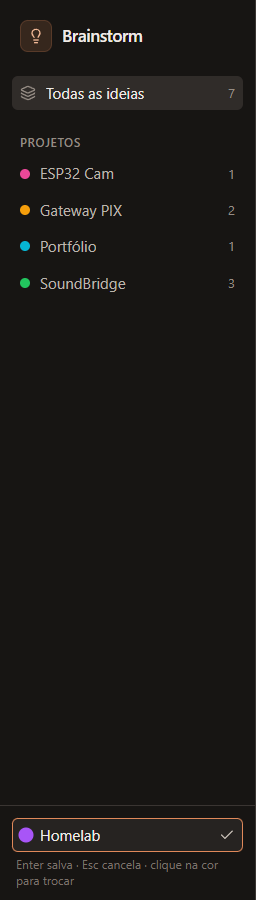
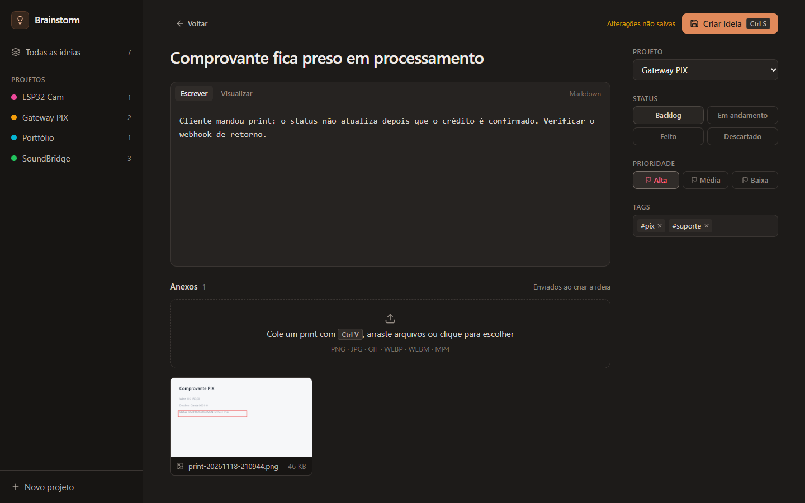
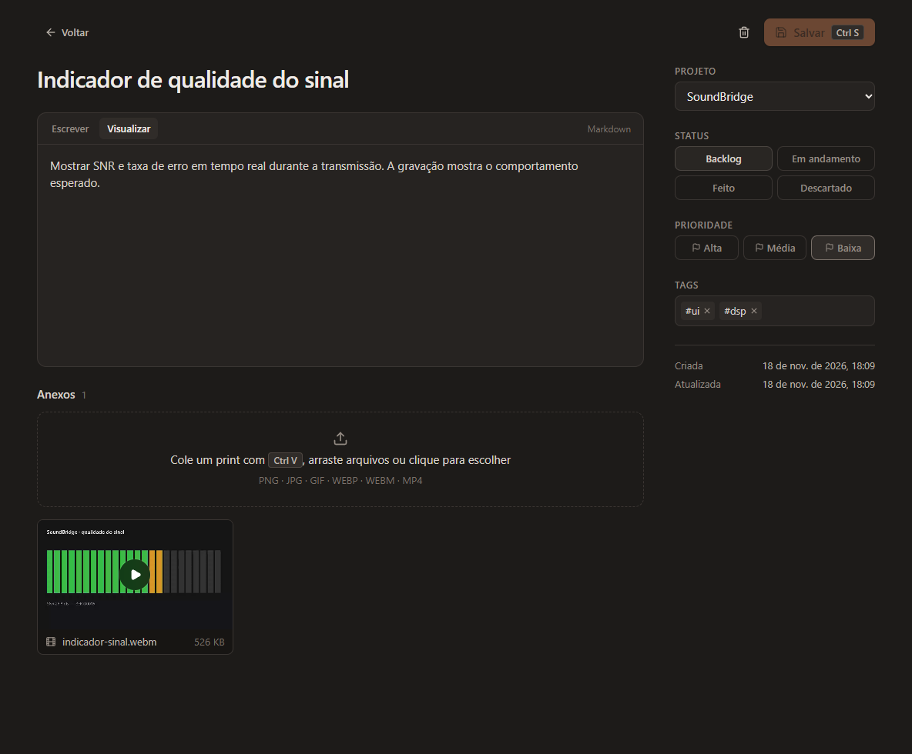
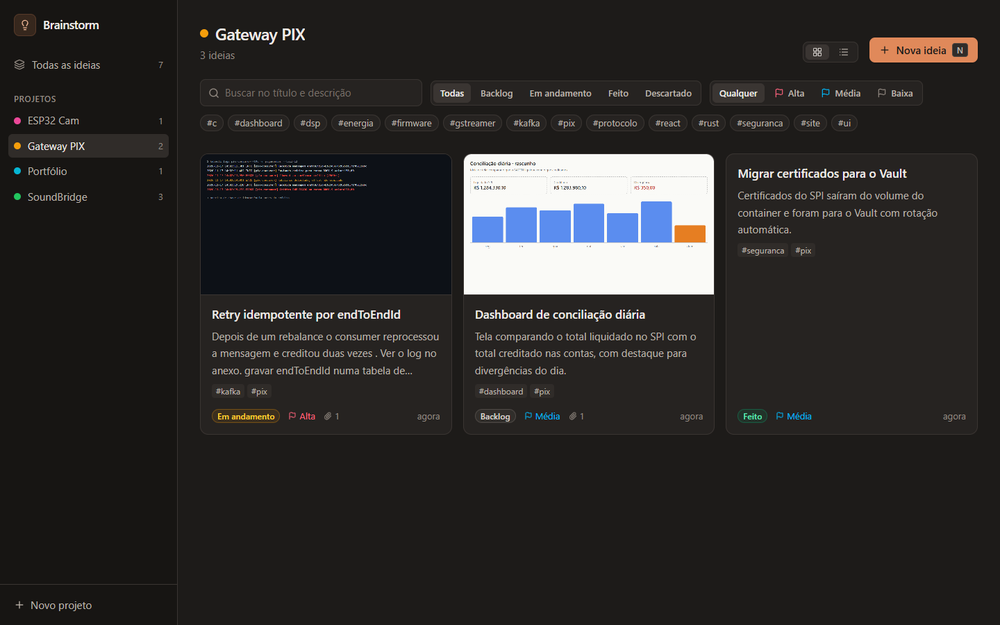
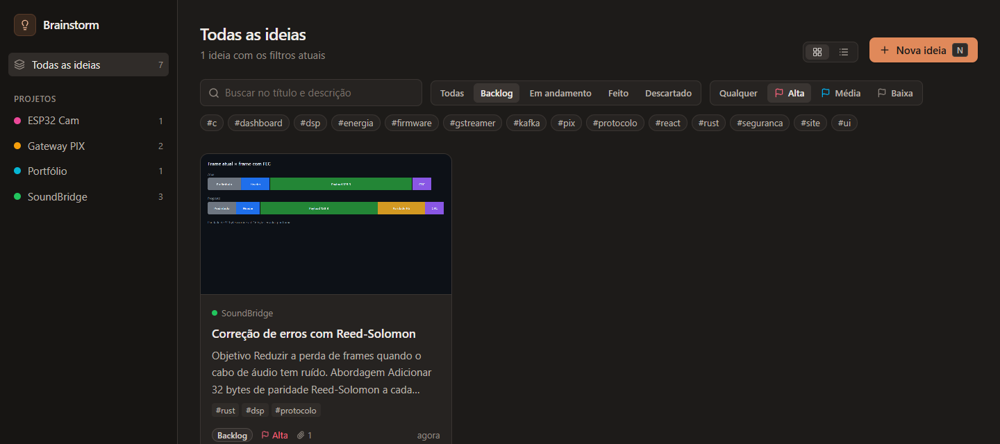
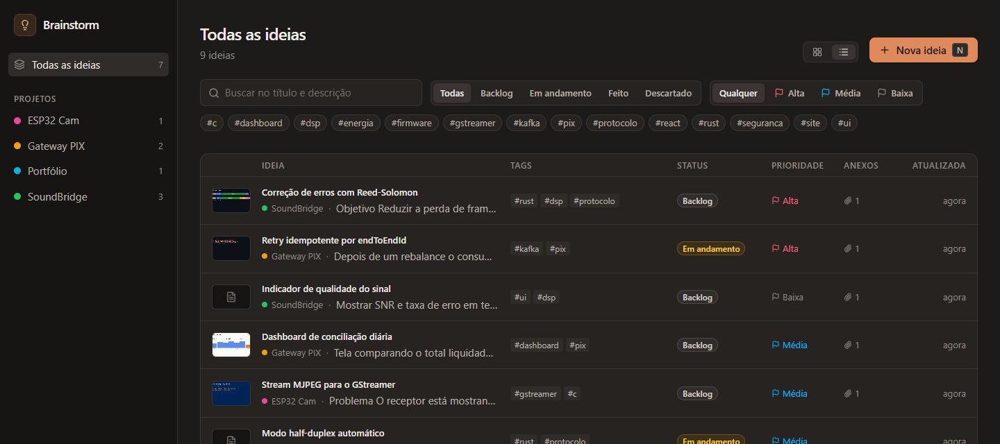

# Brainstorm

Um lugar para guardar as ideias que aparecem no meio do trabalho e que você não pode tocar agora. Cada ideia fica com descrição, prints e gravações de tela, organizada por projeto, para você retomar depois sem perder o contexto.


---

## Sumário

1. [Como abrir](#como-abrir)
2. [Como a ferramenta se organiza](#como-a-ferramenta-se-organiza)
3. [Criar um projeto](#criar-um-projeto)
4. [Registrar uma ideia](#registrar-uma-ideia)
5. [Escrever a descrição](#escrever-a-descrição)
6. [Anexar prints e vídeos](#anexar-prints-e-vídeos)
7. [Encontrar ideias](#encontrar-ideias)
8. [Editar, concluir e excluir](#editar-concluir-e-excluir)
9. [Atalhos de teclado](#atalhos-de-teclado)
10. [Limites e cuidados](#limites-e-cuidados)

---

## Como abrir

O Brainstorm roda no seu computador, dentro do Docker.

1. Com o Docker Desktop aberto, rode na pasta do projeto:

   ```bash
   docker compose up -d
   ```

2. Acesse **http://localhost:8090** no navegador.

Para desligar, use `docker compose down`. Suas ideias e anexos continuam guardados para a próxima vez.

---

## Como a ferramenta se organiza

| Conceito | Para que serve |
|---|---|
| **Projeto** | Agrupa as ideias de uma mesma aplicação. Cada projeto tem uma cor, que aparece nos cards e na barra lateral. |
| **Ideia** | O registro em si: título, descrição, anexos, status, prioridade e tags. |
| **Status** | Em que pé a ideia está: *Backlog* (guardada para depois), *Em andamento*, *Feito* ou *Descartado*. |
| **Prioridade** | *Alta*, *Média* ou *Baixa*. Ajuda a escolher o que puxar primeiro. |
| **Tags** | Palavras livres para cruzar projetos, como `rust`, `ui` ou `seguranca`. |
| **Anexos** | Prints e gravações de tela que mostram o problema ou a ideia. |

O número ao lado de cada projeto na barra lateral conta só as ideias **em aberto**, ou seja, em *Backlog* ou *Em andamento*. O total de ideias aparece no topo da lista.

---

## Criar um projeto

<table>
<tr>
<td width="260"></td>
<td>

1. Clique em **Novo projeto**, no rodapé da barra lateral.
2. Digite o nome.
3. Clique na bolinha colorida para trocar a cor. Cada clique passa para a próxima.
4. Pressione **Enter** para salvar ou **Esc** para cancelar.

Para **renomear** ou **excluir**, passe o mouse sobre o projeto na barra lateral e use o lápis ou a lixeira.

> Excluir um projeto apaga também todas as ideias e anexos dele. A ferramenta pede confirmação antes.

</td>
</tr>
</table>

---

## Registrar uma ideia

Existem três formas de começar uma ideia nova:

- clicar em **Nova ideia**, no canto superior direito;
- pressionar **N** em qualquer ponto da lista;
- **colar um print (Ctrl+V)** direto na lista. Essa é a forma mais rápida: a ideia abre já com o print anexado.

Se você estiver dentro de um projeto quando começar, a ideia já nasce nesse projeto.



Na tela da ideia:

1. **Título**: o cursor já começa nele. Escreva algo curto que você vá reconhecer depois.
2. **Descrição**: o contexto, o problema e o que você pensou em fazer. Veja [Escrever a descrição](#escrever-a-descrição).
3. **Projeto, status e prioridade**: ficam na coluna da direita. Uma ideia nova começa em *Backlog* com prioridade *Média*.
4. **Tags**: digite e pressione **Enter**, **vírgula** ou **espaço** para adicionar. **Backspace** no campo vazio remove a última. As tags que você já usou aparecem como sugestão.
5. Clique em **Criar ideia** ou pressione **Ctrl+S**. A ideia é salva e você volta para a lista do projeto, pronto para registrar a próxima.

Os prints colados antes de salvar aparecem em *Anexos* com o aviso "Enviados ao criar a ideia". O nome do arquivo é gerado com a data e a hora, por exemplo `print-20261118-125635.png`.

---

## Escrever a descrição

A descrição tem duas abas:

- **Escrever**: onde você digita.
- **Visualizar**: mostra o texto formatado.

Quando a ideia já tem descrição, ela abre em *Visualizar*. Dê **dois cliques** no texto para voltar a editar.


A formatação usa Markdown. O básico:

| Você escreve | Resultado |
|---|---|
| `## Objetivo` | Título de seção |
| `**importante**` | **importante** |
| `- item` | Lista com marcadores |
| `1. passo` | Lista numerada |
| `> observação` | Citação em destaque |
| Três crases (` ``` `) antes e depois do trecho | Bloco de código |
| `[texto](https://...)` | Link |

O resultado na aba *Visualizar*:


---

## Anexar prints e vídeos

Dentro de uma ideia, a área *Anexos* aceita arquivos de três formas:

- **colar** um print com **Ctrl+V** em qualquer ponto da página;
- **arrastar** arquivos do computador para a área pontilhada;
- **clicar** na área pontilhada para escolher os arquivos.

Formatos aceitos: **PNG, JPG, GIF, WEBP** para imagens e **WEBM, MP4** para vídeos.

Numa ideia que já existe, o envio é imediato e uma barra mostra o progresso. Numa ideia nova, os arquivos são enviados quando você clica em *Criar ideia*.

Os vídeos aparecem com o ícone de play:



### Ver em tela cheia

Clique em qualquer anexo para abrir o visualizador.


- **← / →** passam para o anexo anterior ou o próximo.
- **Esc** fecha.
- O ícone no canto superior direito baixa o arquivo original.

Para **remover** um anexo, passe o mouse sobre ele e clique na **lixeira** que aparece no canto. Em ideias já salvas, a ferramenta pede confirmação antes.

---

## Encontrar ideias

### Por projeto

Clique num projeto na barra lateral para ver só as ideias dele. **Todas as ideias** volta para a visão geral.



### Por status, prioridade e tag

- Os botões **Todas, Backlog, Em andamento, Feito e Descartado** filtram por status.
- Os botões **Qualquer, Alta, Média e Baixa** filtram por prioridade.
- As tags abaixo da busca filtram por tag. Clique de novo na tag, ou no **×**, para tirar o filtro.

Os filtros se combinam entre si e com o projeto. O topo da lista mostra quantas ideias atendem aos filtros atuais. No exemplo abaixo, só as ideias em *Backlog* com prioridade *Alta*:



### Pela busca

O campo **Buscar** procura no título e na descrição enquanto você digita. Não precisa digitar a palavra inteira.


> Os filtros ficam no endereço da página. Dá para salvar uma busca nos favoritos do navegador ou voltar para ela com o botão *Voltar*.

### Cards ou lista

Os dois botões ao lado de **Nova ideia** trocam a forma de exibir as ideias:

- **Cards**: mostra o primeiro print em destaque. Bom para reconhecer as ideias pelo visual.
- **Lista**: uma ideia por linha, com miniatura, resumo, tags, status, prioridade, anexos e data. Bom para revisar muitas ideias de uma vez.

A ferramenta lembra a última escolha neste navegador. Os filtros funcionam igual nos dois modos.



---

## Editar, concluir e excluir

- **Editar**: abra a ideia, altere o que quiser e clique em **Salvar** ou pressione **Ctrl+S**. A ideia é salva e fechada, e você volta para a lista do projeto dela. Enquanto houver algo não salvo, aparece o aviso *Alterações não salvas*, e o navegador pede confirmação se você tentar fechar a aba. Para sair sem salvar, use **Voltar**.
- **Concluir**: mude o status para **Feito**. Se desistir da ideia, use **Descartado** em vez de excluir: ela some das contagens em aberto, mas continua registrada.
- **Mudar de projeto**: troque o campo *Projeto* na coluna da direita e salve.
- **Excluir**: clique na **lixeira**, ao lado do botão *Salvar*. A exclusão apaga a ideia e todos os anexos dela, e não pode ser desfeita.

A coluna da direita mostra quando a ideia foi criada e quando foi atualizada pela última vez.

---

## Atalhos de teclado

| Atalho | Onde | O que faz |
|---|---|---|
| **N** | Lista de ideias | Abre uma ideia nova |
| **Ctrl+V** | Lista de ideias | Abre uma ideia nova com o print colado |
| **Ctrl+V** | Dentro de uma ideia | Anexa o print colado |
| **Ctrl+S** | Dentro de uma ideia | Salva e volta para a lista do projeto |
| **Enter** | Campo de tags | Adiciona a tag |
| **← / →** | Visualizador | Anexo anterior / próximo |
| **Esc** | Visualizador ou formulário de projeto | Fecha / cancela |

O atalho **N** não funciona enquanto o cursor está num campo de texto, para não atrapalhar a digitação.

---

## Limites e cuidados

- **Tamanho dos arquivos**: até 1 GB por arquivo e até 20 arquivos por envio.
- **Tags**: até 20 por ideia. Elas são gravadas sempre em minúsculas.
- **Uso pessoal**: a ferramenta não tem login. Use só no seu computador e não deixe o endereço acessível para outras pessoas da rede.
- **Backup**: as ideias e os anexos ficam guardados em dois lugares separados do Docker, um para o banco de dados e outro para os arquivos. Um backup completo precisa copiar os dois.
- **Vídeos gravados no navegador**: algumas gravações em WEBM, principalmente as feitas por extensões do navegador, não informam a duração. Elas tocam normalmente, mas a barra de progresso pode não deixar avançar para um ponto específico.
- **Não apague com `docker compose down -v`**: o `-v` apaga os dados guardados, ou seja, todas as ideias e anexos.
